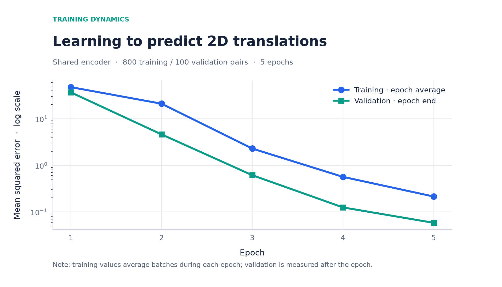
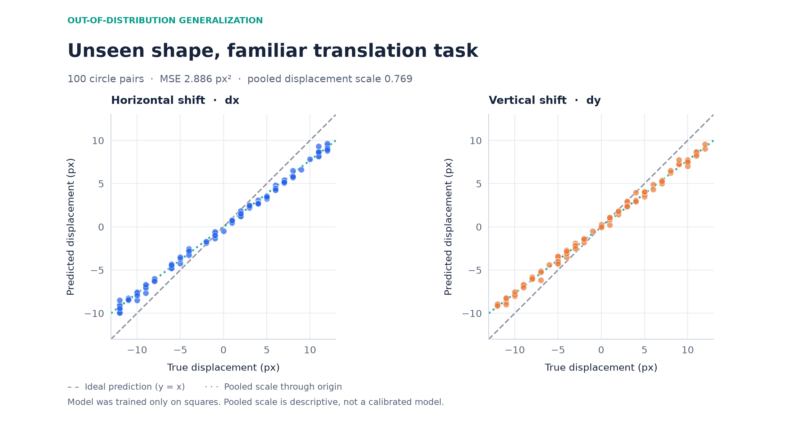

# Representation Lab

**A small, reproducible experiment on task-relevant representations and generalization across shapes.**

Can a model learn to infer a geometric transformation from a pair of images? More importantly, does an accurate predictor learn a representation that generalizes when the *object* changes but the *task* stays the same?

This repository explores those questions using 64 × 64 binary images, integer translations, a shared CNN encoder, and an exact geometric baseline. It is an exploratory learning project inspired by questions about representation and computational simplification—not an official replication or validation of a research paper.

## Experiment at a glance

- **Training objects:** filled 16 × 16 squares at randomized starting positions.
- **Task:** estimate horizontal and vertical translation `(dx, dy)` from the original and moved images.
- **Training data:** 1,000 square pairs, split into 800 training, 100 validation, and 100 held-out test pairs.
- **Zero-shot shape test:** 100 previously unseen circle pairs (radius 8 pixels).
- **Translation range:** integer displacements in `[-12, 12]` for both axes, with no image clipping in these experiments.
- **Baselines:** a learned paired-image CNN predictor versus displacement computed from differences in image centroids.

Positive `dx` moves an image right; positive `dy` moves it down.

## Methods

### Shared CNN and latent difference

The same CNN encoder processes the original image and its translated version. Its output is a 32-dimensional latent vector, and a linear head predicts the two translation coordinates from the difference:

\[
 z_o = f_\theta(x), \qquad z_m = f_\theta(T_g x), \qquad
 \hat g = W(z_m-z_o)+b.
\]

The encoder uses two convolutional layers with ReLU, adaptive average pooling to an 8 × 8 grid, and a fully connected projection to 32 dimensions. Training uses MSE loss and Adam for five epochs. The encoder weights are shared across both image inputs.

This architecture can *read out* translation information from latent differences. Low prediction error alone does **not** establish that the entire latent space is translation-equivariant.

### Geometric baseline

For images without foreground cropping, the centroid of translated foreground pixels shifts by exactly the translation vector. The baseline therefore predicts

\[
 \hat g_{\mathrm{centroid}} = c(T_gx)-c(x),
\]

where `c` is the foreground-pixel centroid. It requires neither training nor an object-specific model. The baseline's exact result depends on the current controlled setup and should not be generalized to images with cropping, noise, or ambiguous foregrounds.

## Results

All MSE values average squared errors over *both* displacement coordinates, in pixels squared.

| Evaluation | Paired CNN MSE | Centroid MSE |
|:--|--:|--:|
| Held-out squares (n = 100) | **0.137117** | 0.000000 |
| Unseen circles (n = 100) | **2.886089** | 0.000000 |

The CNN performs well on held-out examples from the square training distribution, but it loses accuracy when evaluated on circles without retraining. On the circle test, predictions tend to have a smaller magnitude than the true displacement. The pooled scale through the origin,

\[
 s = \frac{\sum_i \hat g_i \cdot g_i}{\sum_i \lVert g_i \rVert^2},
\]

is approximately **0.768967** (descriptive, not a fitted correction used at inference time).

### Training and validation



Training errors are averages of minibatch losses collected *during* the epoch, whereas validation errors are evaluated using the final parameters *after* that epoch. They should be interpreted as trends rather than perfectly matched measurements of the same parameter state.

### Zero-shot generalization to circles



A perfect predictor would fall on the `prediction = target` diagonal. The CNN's estimates are systematically closer to zero at larger displacement magnitudes.

### Latent-difference stability (exploratory diagnostic)

For each of 20 square starting positions, we computed

\[
 \Delta z_i(g) = f_\theta(T_g x_i) - f_\theta(x_i).
\]

For each fixed translation, the **within-shift distance** is the mean Euclidean distance from its group's mean latent difference. The **between-shift distance** is the Euclidean distance between the two group means.

| Quantity | Mean Euclidean distance |
|:--|--:|
| Within `(7, -4)` | 1.779809 |
| Within `(-7, 4)` | 2.062127 |
| Between the two mean latent differences | 17.894482 |

These two widely separated, opposite shifts produce clearly distinct mean latent differences, while variation across starting positions is smaller. This is **not** proof of equivariance: only two transformations were compared, and components of the latent difference not used by the prediction head may still vary.

## Reproduce the experiment

Requires Python, NumPy, Matplotlib, and PyTorch. The scripts run on CPU; GPU support is not required.

Create a virtual environment and install dependencies (PowerShell example):

```powershell
python -m venv .venv
.\.venv\Scripts\Activate.ps1
pip install -r requirements.txt
```

Run the checks, train the model, and evaluate it:

```powershell
python data.py
python train_paired.py
python evaluate.py
python plot_results.py
```

- `train_paired.py` writes `checkpoints/paired_square.pt`, including model weights, split indices, seeds, and training history.
- `evaluate.py` loads the checkpoint and prints square/circle accuracy, the centroid baselines, and the latent diagnostic.
- `plot_results.py` loads the same checkpoint and writes two PNGs in `figures/`.
- `data.py` can be run directly for sanity and reproducibility checks.

**Seeds:** square data and training `42`; circle test `2026`; latent diagnostic `2027`. Observed results were obtained with the reported local PyTorch CPU setup. Small numeric differences are possible across platforms and software versions. If a pretrained checkpoint is not present, run the training script first.

## Repository layout

```text
representation-lab/
├── data.py                 # Binary shapes and translation datasets
├── model.py                # Shared CNN encoder
├── baseline.py             # Centroid-based translation estimator
├── train_paired.py         # Training and checkpoint export
├── evaluate.py             # Test metrics and latent analysis
├── plot_results.py         # Reproducible figures
├── train.py                # Earlier single-image prototype (legacy)
├── checkpoints/
│   └── paired_square.pt    # Created by the training script
├── figures/
│   ├── training_curve.png
│   └── circle_zero_shot_scatter.png
└── requirements.txt
```

## Limitations and next steps

This is a deliberately constrained setting: binary images, simple shapes, known translations, no clipping, and only one training seed and one cross-shape test set. The square training/test split is a random split of generated samples, **not** a guarantee of disjoint initial positions or translation values. Circles also differ from squares in their foreground area and geometry, so their performance gap cannot be attributed to a single factor.

The geometric centroid baseline is unusually strong here because the data were designed to preserve the foreground exactly. In realistic scenes, segmentation, occlusion, clipping, and visual clutter complicate this baseline.

Future directions include evaluating additional shapes and displacement ranges, stress-testing clipping and noise, studying the structure of latent changes across *many* transformations, and exploring explicit transformation-aware or probabilistic models.

## Scope

An independent, educational research prototype. It does not claim to prove a general theory of representation learning, and it is not affiliated with any lab or research group.
